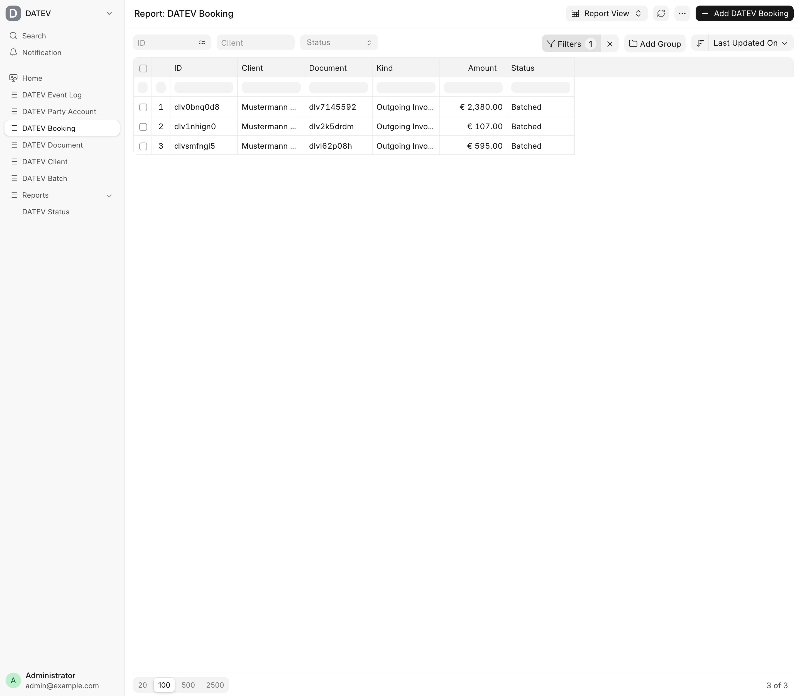

A DATEV integration for the Frappe Framework: bookings with Beleglink, EXTF and DATEVconnect

# DATEV for Frappe

The `datev` app delivers bookings to DATEV complete and with a document link (Beleglink), so the tax office does not have to match receipts by hand. It keeps one booking per voucher, controls when and what is sent, and makes sure nothing is sent twice.

It works with any source system through the [intake API](docs/intake-api.md). For ERPNext, the adapter app [datev_erpnext](https://github.com/EffizienzAgent/datev_erpnext) feeds submitted sales invoices automatically. This core app depends on Frappe only.

> **Work in progress.** This app has not been verified against a real DATEV Rechnungswesen, DATEVconnect or Business OS yet; the trial import is pending. APIs and doctypes may change before 1.0. Use at your own risk and start with a test client. New here? Read the [integration guide](docs/integration.md).

## Status

The first release covers sales invoices (including cancellation invoices) delivered through the intake API or Python, document storage in DATEV Unternehmen online (DUo) via Business OS or by e-mail, and booking export via DATEVconnect or EXTF files (download or e-mail). ERPNext sales invoices arrive through [datev_erpnext](https://github.com/EffizienzAgent/datev_erpnext). Payments, incoming invoices, a generic webhook storage connector and [DocArchive](https://github.com/EffizienzAgent/docarchive) as storage are planned.

## No compliance promise

datev is a technical tool. It does not make you compliant with DATEV requirements, GoBD or any other law or standard, and it gives no tax advice. Account numbers, tax keys, document types and procedures are your responsibility. Check them with your tax advisor.

## Features



**Documents and Beleglink**
- [Documents with Beleglink](docs/concepts.md#data-model): every booking points to a document, with a GUID known before upload.
- [Business OS and e-mail to DUo](docs/connectors.md#document-storage) as storage connectors.
- [Belegtypen per client](docs/connectors.md#document-types): defaults, own options and rules.

**Bookings and export**
- [One booking per voucher](docs/concepts.md#data-model) with party account, contra account, BU key and Belegfeld 1.
- [DATEVconnect](docs/connectors.md#datevconnect) posting proposals and master data.
- [EXTF files](docs/extf.md) (Buchungsstapel and Debitoren/Kreditoren) per fiscal year, as download or by e-mail.

**Control**
- [Dispatch schedule and approval](docs/concepts.md#flow): daily, weekly or monthly, with release by the responsible person and held bookings.
- [Duplicate protection](docs/concepts.md#duplicate-protection): transferred bookings are never sent again; uncertain deliveries wait for `resolve_batch`.
- [Party accounts](docs/concepts.md#party-accounts) with number assignment and matching against existing DATEV accounts.
- [Status report and notifications](docs/concepts.md#visibility) for pending, stuck and overdue items, and EXTF files until the tax office confirms the import.
- [Intake API](docs/intake-api.md) for documents, parties and bookings.
- [German translations](docs/development.md#translations) for the whole UI.

## Documentation

- [Integration guide](docs/integration.md): install, set up a client, feed data, daily operation, go-live checklist
- [Concepts](docs/concepts.md): data model, statuses, flow, duplicate protection
- [Connectors](docs/connectors.md): storage, export and master data, adding your own
- [EXTF](docs/extf.md): format, files, Beleglink, encoding
- [Intake API](docs/intake-api.md)
- [Development](docs/development.md): dev bench, tests, translations

## Installation

```bash
bench get-app https://github.com/EffizienzAgent/datev --branch version-16
bench --site <site> install-app datev
```

**Compatibility:** Frappe v16. Next: the [integration guide](docs/integration.md).

With ERPNext, also install the adapter:

```bash
bench get-app https://github.com/EffizienzAgent/datev_erpnext --branch version-16
bench --site <site> install-app datev_erpnext
```

## Related apps

- [datev_erpnext](https://github.com/EffizienzAgent/datev_erpnext): ERPNext adapter. Turns submitted sales invoices and cancellation invoices into documents, bookings and party accounts of this app.
- [DocArchive](https://github.com/EffizienzAgent/docarchive): WORM archive for business documents. Planned as a storage connector, so archived documents can serve as the document image or carry their own Beleglink. Not connected yet.
- [einvoice-reader](https://github.com/EffizienzAgent/einvoice-reader): reads ZUGFeRD, Factur-X and XRechnung into one JSON. Planned as the intake for incoming invoices.
- [s3storage](https://github.com/EffizienzAgent/s3storage): stores Frappe files, including document images, in S3-compatible storage.

## Professional setup & support

Need help setting this up or integrating it into your Frappe stack? Write to oss@effizienzagent.de (English or German). German-speaking SMEs: see [mittelstandshub.de](https://mittelstandshub.de).

## License

MIT
