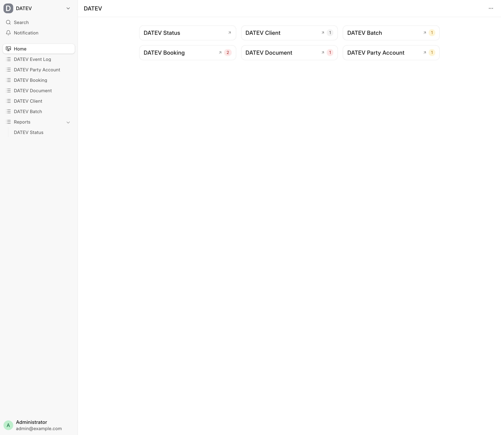
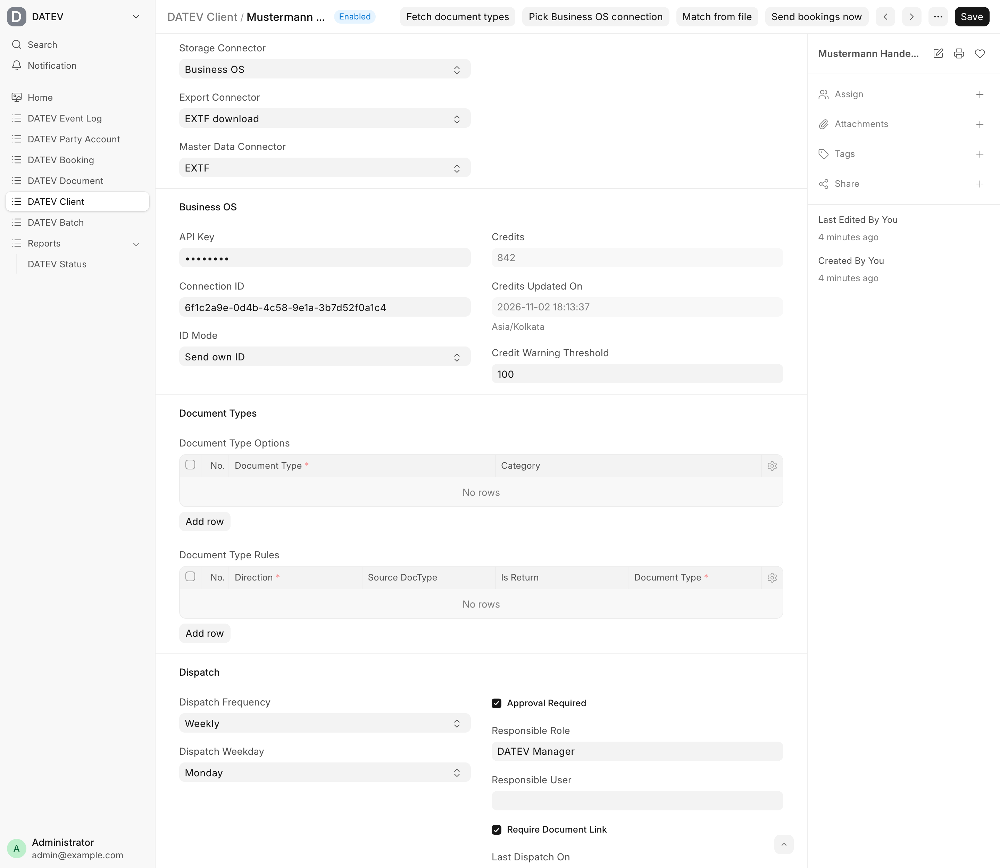
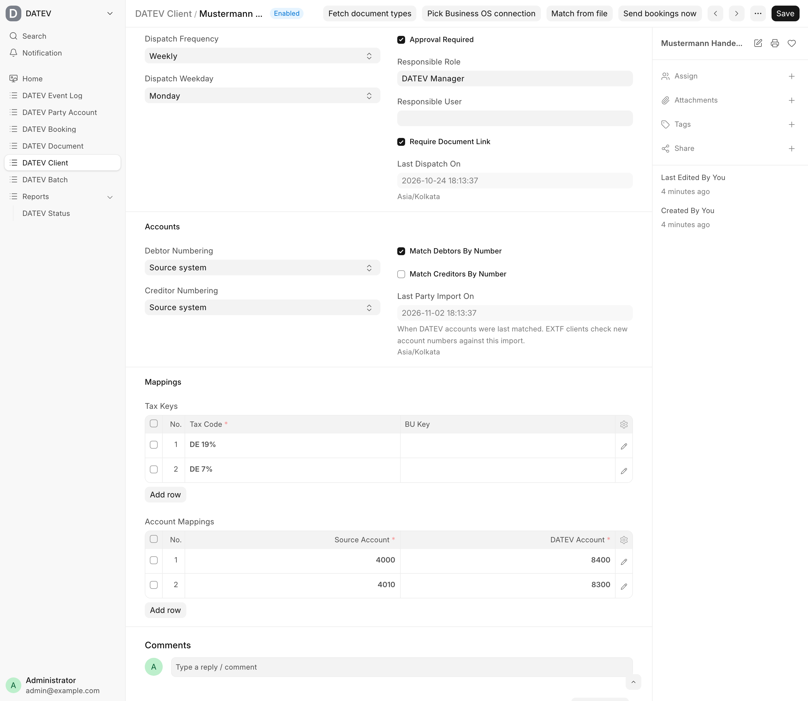
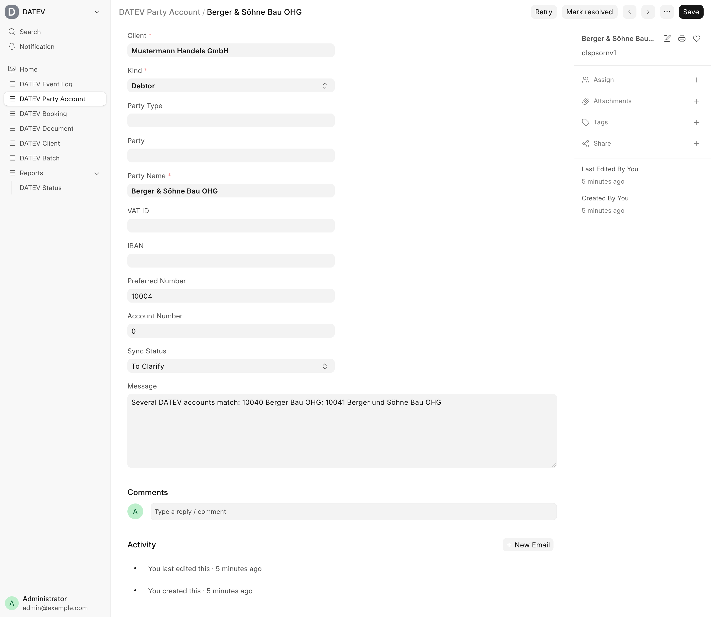
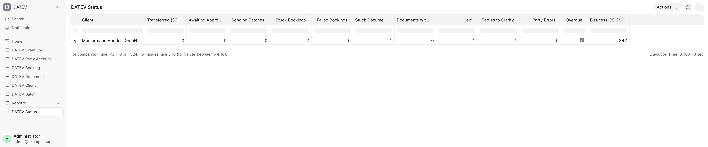
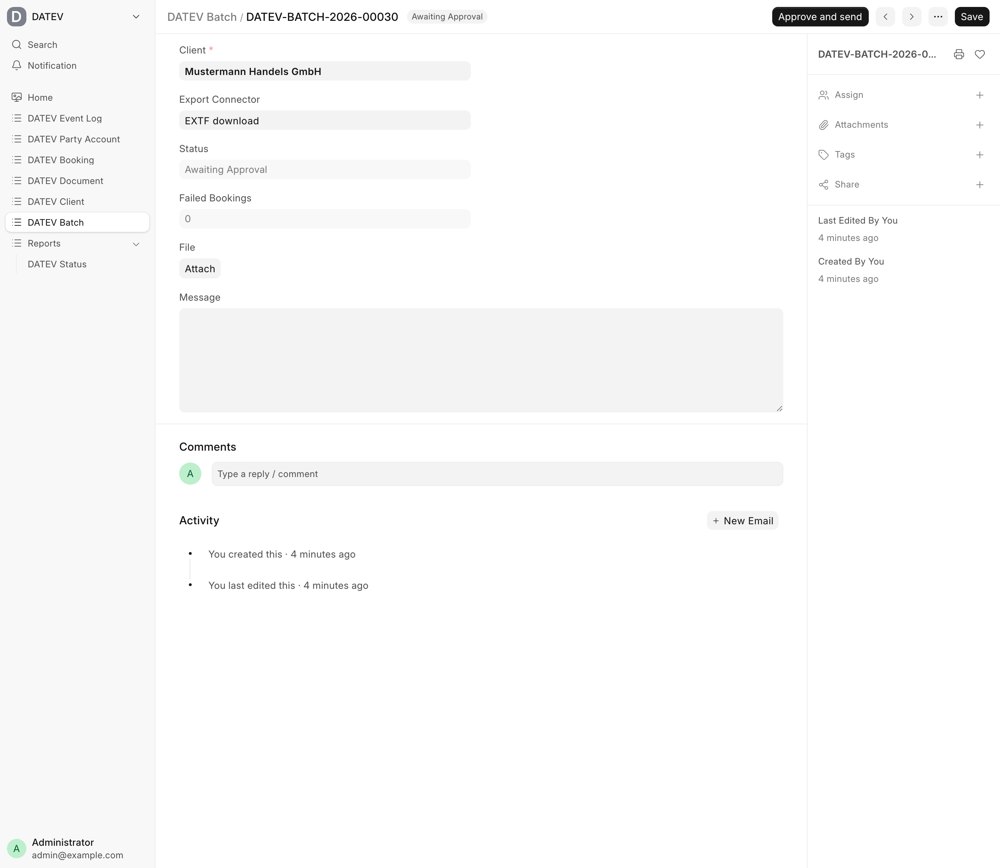
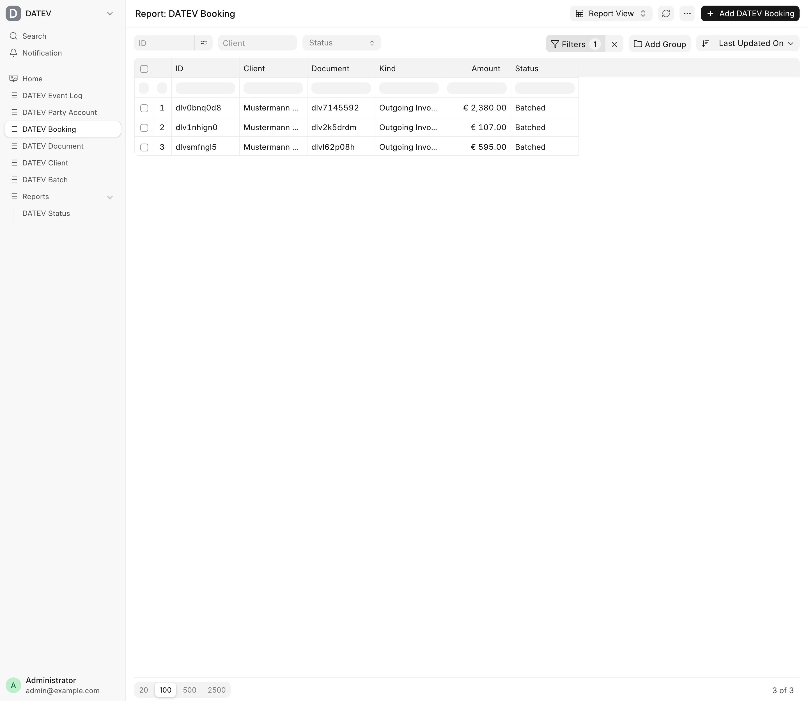
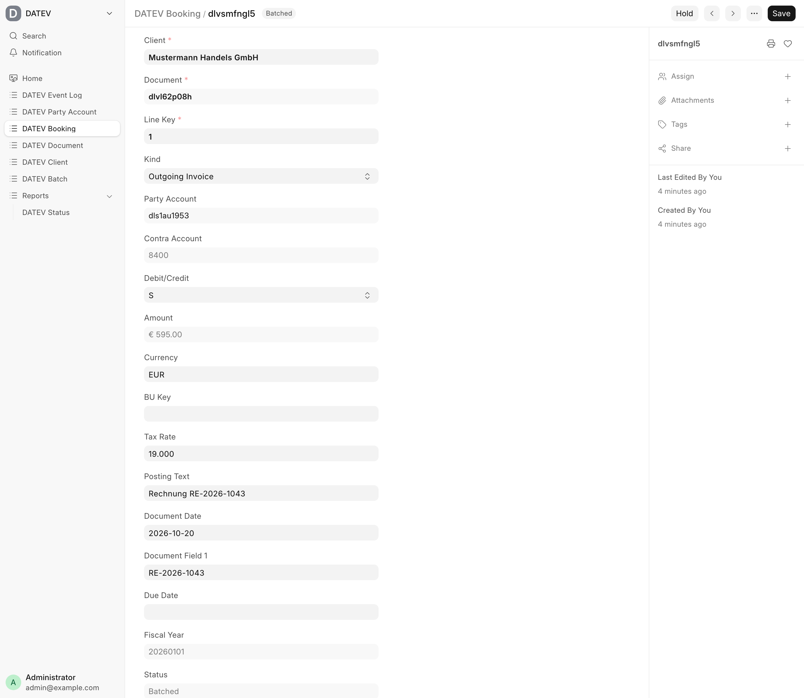
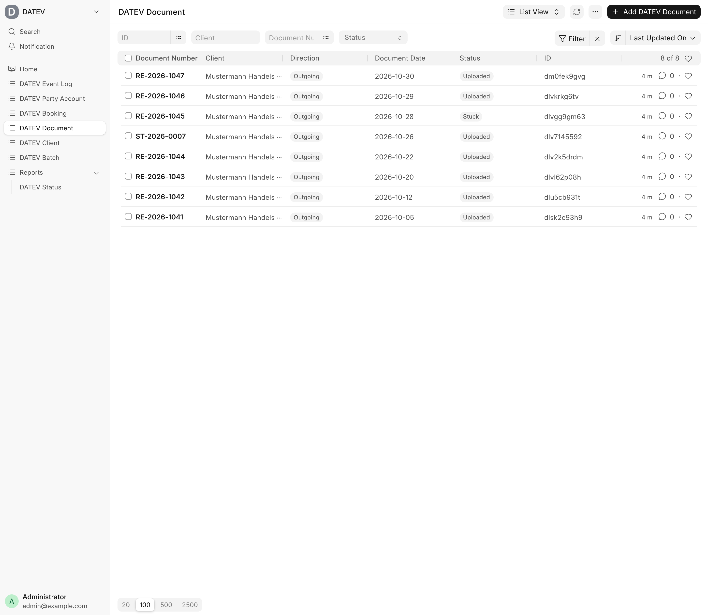
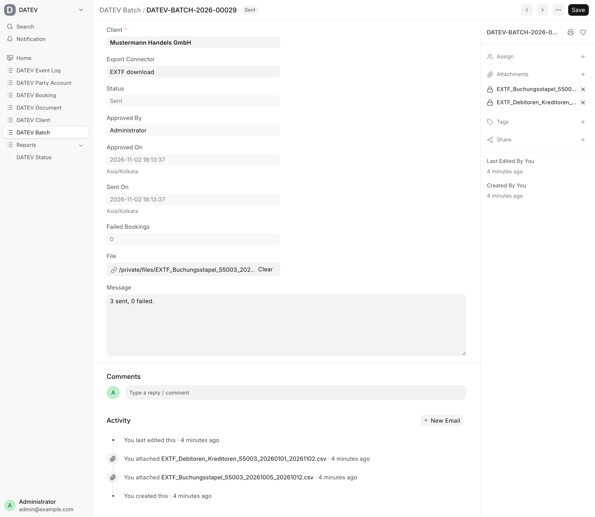

# Integration guide

How to install `datev`, set up a DATEV Client, feed it with invoices and run it day to day. Read the [concepts](concepts.md) first if you want the background.

> Work in progress: not yet verified against a real DATEV system. Do the [go-live checklist](#going-live-checklist) with a test client first.



## Install

```bash
bench get-app https://github.com/EffizienzAgent/datev --branch version-16
bench --site <site> install-app datev
```

The install creates two roles:

| Role | Can |
| --- | --- |
| DATEV Manager | Edit clients, approve, resolve batches, reset bookings, retry party accounts, fetch connector data |
| DATEV User | Read, approve batches, hold and release bookings, send bookings now |

Give the people who approve batches one of them, or name them as responsible user or role on the client. Source systems authenticate with an API key of a user holding one of the roles.

## Set up a DATEV Client

One DATEV Client is one DATEV Mandant. Open **DATEV Client > New**.

1. **Mandate.** Title, consultant number (Beraternummer), client number (Mandantennummer), chart (SKR03 or SKR04), account length (Sachkontenlänge, usually 4; personal accounts have one digit more) and the fiscal year start month. Ask your tax advisor for the numbers; DATEV's samples are consultant 29098 and client 55003.
2. **Connectors.** Choose storage connector, export connector and master data connector (see [connectors](connectors.md)).

   

   - Business OS (document storage in DUo): paste the API key, save, then **Pick Business OS connection**. The dialog lists your connections and preselects the one that matches the consultant and client number. Then **Fetch document types** loads the Belegtypen. Keep ID Mode `Send own ID` so the Beleglink is known before upload.
   - E-mail to DUo instead: enter the client's DUo address. Documents have no Beleglink then.
   - DATEVconnect: base URL (for example `https://host:58452/datev/api/accounting/v1`), user name, password and "Verify TLS Certificate" (switch it off only for self-signed certificates). The DATEVconnect client ID is looked up and saved on first use.
   - EXTF e-mail: the address that receives the files. EXTF download needs nothing, the files are attached to the batch.
3. **Dispatch.** Frequency (daily, weekly, monthly) and day, **Approval Required** (recommended), responsible user or role, and **Require Document Link** (bookings wait until their document has a Beleglink).

   

4. **Numbering.** Debtor and creditor numbering: `Source system` (preferred number from the delivering system) or `DATEV next available` (needs DATEVconnect as master data connector). "Match debtors/creditors by number" links an existing DATEV account with the same number.
5. **Tax keys.** One row per tax code of your source system with the BU key. Leave the BU key empty for automatic accounts (for example 8400 with 19 %).
6. **Account mappings.** Optional: source account to DATEV account, applied to the contra account on export.

Save. Disabled clients receive documents but upload nothing until they are enabled.

## Initial party matching

Before the first batch, match the debtors and creditors that already exist in DATEV, so the app links them instead of creating duplicates.

- With DATEVconnect: **Match DATEV accounts** on the client.
- With a master data file: export the debtors/creditors from DATEV (category 16) and use **Match from file**.

Existing accounts are linked by number (if enabled), VAT ID, IBAN or name. Ambiguous or colliding hits become Party Account "To Clarify" and are neither created nor booked until someone decides. The EXTF master data connector requires this import before it creates any account.



## Feeding data

A delivery consists of a document (the invoice PDF), the party account it belongs to and one booking per voucher line. Every call is idempotent, so you can repeat it after an error or an update.

### From a Frappe app (Python)

`datev.intake` has four functions:

```python
ensure_party_account(client, kind, *, party_type, party, party_name, vat_id=None, iban=None, preferred_number=None) -> str
upsert_document(client, source_key, *, direction, file_name, content, document_date, document_number, amount,
                currency="EUR", source_doctype=None, source_name=None, is_return=False) -> str
add_booking(document, line_key, *, kind, party_account, contra_account, amount, debit_credit,
            tax_rate=0, bu_key="", posting_text="", due_date=None, tax_code=None) -> str
discard_document(source_key) -> None
```

`ensure_party_account` returns the party account name, `upsert_document` and `add_booking` return the document and booking names. `kind` of a party is `Debtor` or `Creditor`; the booking `kind` is `Outgoing Invoice`, `Incoming Invoice` or `Payment`. Amounts are gross and always positive, `debit_credit` is `S` (debit) or `H` (credit). Pass `tax_code` to take the BU key from the client's tax keys, or `bu_key` directly.

The upload is queued after commit, so call these inside a normal request or job that commits.

**Worked example: sales invoice with two revenue lines.** Net 1,000.00 at 19 % on 8400 and net 200.00 at 7 % on 8300, gross 1,190.00 and 214.00.

```python
import frappe
from frappe.utils import flt

from datev import intake

CLIENT = "Mustermann Handels GmbH"


def send_invoice(sinv) -> None:
	pdf = frappe.get_print("Sales Invoice", sinv.name, as_pdf=True)

	debtor = intake.ensure_party_account(
		CLIENT,
		"Debtor",
		party_type="Customer",
		party=sinv.customer,
		party_name=sinv.customer_name,
		vat_id=sinv.tax_id,
		preferred_number=int(sinv.customer_number),
	)
	document = intake.upsert_document(
		CLIENT,
		sinv.name,
		direction="Outgoing",
		file_name=f"{sinv.name}.pdf",
		content=pdf,
		document_date=sinv.posting_date,
		document_number=sinv.name,
		amount=sinv.grand_total,
		currency=sinv.currency,
		source_doctype="Sales Invoice",
		source_name=sinv.name,
		is_return=bool(sinv.is_return),
	)
	lines = [  # (revenue account, gross amount, tax rate)
		(8400, flt(1190), 19),
		(8300, flt(214), 7),
	]
	for number, (account, gross, rate) in enumerate(lines, start=1):
		intake.add_booking(
			document,
			str(number),
			kind="Outgoing Invoice",
			party_account=debtor,
			contra_account=account,
			amount=gross,
			debit_credit="H" if sinv.is_return else "S",
			tax_rate=rate,
			tax_code=f"DE {rate}%",
			posting_text=f"Rechnung {sinv.name}",
		)
```

All lines share the invoice number in Belegfeld 1 and the Beleglink of the one document.

**Cancellation invoice.** It is its own document and its own bookings. Deliver it exactly like the invoice with `is_return=True` and `debit_credit="H"` (the amounts stay positive), under its own source key:

```python
debtor = intake.ensure_party_account(
	CLIENT,
	"Debtor",
	party_type="Customer",
	party="CUST-0001",
	party_name="Hansen Elektrotechnik GmbH",
	preferred_number=10001,
)
document = intake.upsert_document(
	CLIENT,
	"SINV-0001-RET",
	direction="Outgoing",
	file_name="SINV-0001-RET.pdf",
	content=pdf,
	document_date="2026-10-26",
	document_number="ST-2026-0007",
	amount=1404,
	is_return=True,
)
intake.add_booking(
	document,
	"1",
	kind="Outgoing Invoice",
	party_account=debtor,
	contra_account=8400,
	amount=1190,
	debit_credit="H",
	tax_rate=19,
	tax_code="DE 19%",
)
intake.add_booking(
	document,
	"2",
	kind="Outgoing Invoice",
	party_account=debtor,
	contra_account=8300,
	amount=214,
	debit_credit="H",
	tax_rate=7,
	tax_code="DE 7%",
)
```

Rules to know:

- An invoice that is already in DATEV cannot be discarded. Create a cancellation invoice instead; invoice and cancellation are both sent.
- Before the upload a document can be withdrawn with `intake.discard_document(source_key)`. Its open bookings are deleted.
- Calling `upsert_document` or `add_booking` again updates the record while it is still open (Pending or Stuck, bookings also Failed). Uploaded documents and transferred bookings are returned unchanged.
- The Belegtyp is chosen by the client's rules (default `Rechnungsausgang`, `Rechnungseingang`, `Sonstige`).

### From external systems (HTTP API)

n8n, scripts or any other system call the four whitelisted methods `submit_document`, `submit_party`, `submit_booking` and `status`, see [intake API](intake-api.md). In n8n an HTTP Request node with a header credential `Authorization: token <api_key>:<api_secret>` is enough: call `submit_party`, then `submit_document` with the base64 PDF, then `submit_booking` once per line using the names returned. Poll `status` with the `source_key` to see the document and its bookings.

A separate app, `datev_erpnext`, is planned. It feeds sales invoices, cancellation invoices and parties from ERPNext automatically, so with ERPNext you will not write the code above yourself.

## Daily operation



- **Status report.** Open the report **DATEV Status** every day or let the notifications tell you. Problem clients are listed first.
- **Approve a batch.** On the dispatch date the app builds a batch of all ready bookings. With approval required it waits as "Awaiting Approval". Open it, check the bookings, press **Approve and send**. The transfer runs as background job.

  

  

- **Hold a booking.** **Hold** on a booking removes it from the batch; it moves to a later batch after **Release**. Only Pending bookings and bookings in a batch that still awaits approval can be held.

  

- **Send bookings now** on the client builds an extra batch outside the schedule.
- **Stuck items.** A Stuck booking has a message (document not uploaded, party account not ready, fiscal year locked, ...). Fix the cause; the booking joins the next batch by itself. A Stuck document is retried with backoff (5 min, 30 min, 2 h, 12 h) and after five attempts waits for a manual retry. Check DUo first if the message says the upload may have arrived.

  

- **Party accounts.** Retry a party in "Error" or "To Clarify" with **Retry** (`datev.parties.retry_party`), or enter the number of the existing DATEV account with **Mark resolved**.
- **Reset a booking.** Only if a transferred or exported booking is known to be missing in DATEV: **Reset to Pending** on the booking, with a reason (`datev.dispatch.reset_booking(booking, reason)`, DATEV Manager).
- **Uncertain deliveries.** If a DATEVconnect request may have arrived but the answer is missing, the batch stays "Sending" and is never retried automatically. Check in DATEV what arrived, then resolve it on the batch: **Resolve > Arrived in DATEV** or **Not in DATEV** (`datev.dispatch.resolve_batch(batch, delivered)`, DATEV Manager). `delivered=1` marks the bookings as transferred, `delivered=0` returns them to Pending.
- **Exported batches.** With EXTF connectors the files are attached to the batch and can be downloaded again.

  

- **Notifications.** The responsible user or role is notified once a day per reason: batch awaiting approval, dispatch overdue, stuck items, batch sending for over an hour, Business OS credits low.

## Going live checklist

1. Create a **test client** first (a test Mandant at your tax advisor) and run everything there.
2. Deliver a few invoices, including one with two tax rates and one cancellation invoice.
3. Do a **trial import** of the batch (EXTF file or DATEVconnect) with your tax advisor and check amounts, accounts, BU keys and Belegfeld 1.
4. Check that the **Beleglink opens the document image** in DATEV (`BEDI` plus ID).
5. Switch off **pre-coding / automation (Vorkontierung) in DUo** for these documents, otherwise DATEV books them a second time. Clarify this with your tax advisor.
6. Match the existing parties, clear every "To Clarify".
7. Set approval, responsible user and dispatch schedule, then create the production client.
8. Keep approval on for the first weeks.

datev is a technical tool and gives no tax or compliance advice, see [No compliance promise](../README.md#no-compliance-promise).
